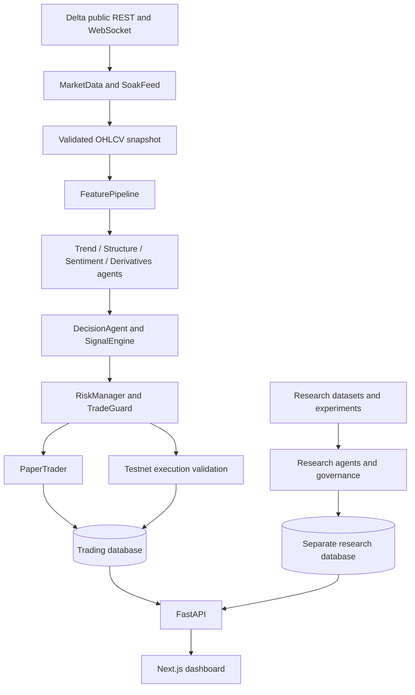

# Bot Architecture

## System context

The project is organized around a Python 3.12 application and a Next.js dashboard. The backend owns market data, feature engineering, signal generation, risk decisions, paper execution, persistence, API endpoints and research governance.

## Main packages

| Package | Responsibility |
|---|---|
| `app/agents` | Directional votes from trend, structure, sentiment and derivatives |
| `app/analysis` | Analysis service, strategy catalog and leverage-related calculations |
| `app/backtest` | Causal simulator, parameter optimization, study and walk-forward validation |
| `app/config` | Environment settings and immutable TradingProfile |
| `app/data` | Delta REST client, WebSocket, market state, cache, historical data, news, quality and resampling |
| `app/database` | SQLAlchemy engine, sessions and persisted trading/operational models |
| `app/execution` | Modes, brokers, adapters, guard, order manager, recovery and validation |
| `app/features` | Shared causal feature pipeline |
| `app/indicators` | Technical and derivatives feature calculations |
| `app/instruments` | Instrument models, providers, registry and watchlist |
| `app/ops` | Backup utilities |
| `app/portfolio` | Portfolio exposure checks |
| `app/research` | Offline experiments, LLM agents, storage and governance |
| `app/risk` | Risk settings, sizing, state, decisions, manager and kill switch |
| `app/soak` | Continuous paper-only soak runner and telemetry |
| `app/strategy` | Strategy identity, signal contract, validation, scoring and signal engine |
| `app/trading` | Runner, local paper trader and trading order types |
| `dashboard` | Next.js UI, API client, types and control/research components |
| `tests` | Unit, integration, architecture, safety, phase and VPS-readiness tests |

## Startup lifecycle

The FastAPI lifespan in `app/main.py` validates settings, initializes the trading database, constructs market data and a multi-symbol health monitor, builds a paper TradingProfile, creates a KillSwitch and RiskManager, restores/reconciles the PaperTrader, records an initial equity snapshot, constructs SignalEngine and TradingRunner, then starts the market, monitor and runner tasks. Shutdown stops the runner/monitor and cancels background tasks.

The paper runner processes closed candles only. It manages an open paper position against the latest closed bar, evaluates new signals after the startup cursor is seeded, validates signal/data quality and persists signal/profile/provenance context.

## Data and state boundaries

Trading/account state is stored under `DATABASE_URL` (default `data/trading.db`). Research datasets and experiment/governance state use `RESEARCH_DATABASE_URL` (default `data/research.db`). The settings validator rejects identical URLs. Research/backtest execution modes are prohibited from writing trading state or submitting orders.

## Contracts and coupling

`TradingProfile` binds mode, symbol, timeframe, strategy identity/version, EMA spans, weights, thresholds, risk settings, contract value and paper cost assumptions. It is immutable and rejects unsupported live mode. `app/contracts.py` defines shared typed contracts for signals, orders, risk decisions and execution modes.

## Runtime components

- FastAPI: `app.main:app`
- Python module entry point: `python -m app`
- Paper runner: `app.trading.runner.TradingRunner`
- Paper simulator: `app.trading.paper_trader.PaperTrader`
- Soak runner: `python -m app.soak`
- Backtest study: `python -m app.backtest.study`
- Dashboard: Next.js app in `dashboard/`

## Architecture invariants

1. A signal is not an order approval.
2. Risk approval is produced by the deterministic risk manager.
3. Every execution adapter revalidates mode and request/risk-decision consistency.
4. Paper trading does not call Delta order endpoints.
5. Research agents are read-only and cannot access execution/risk/order modules.
6. Research/backtest cannot mutate trading state.
7. Live execution is disabled in code for this release.
